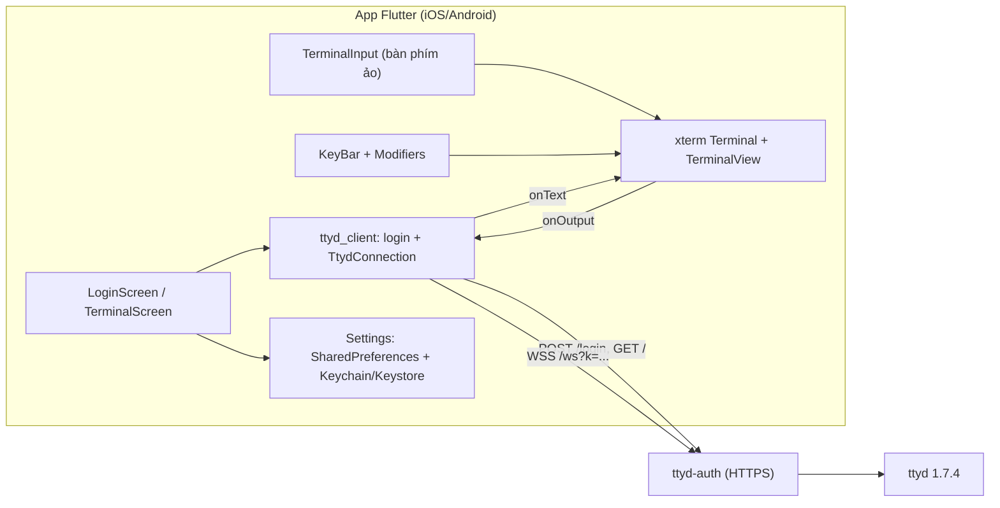

# Kiến trúc ttyd keys

## 1. Bức tranh tổng thể



- App chỉ là client; không có backend riêng trong repo. Server là ttyd-auth + ttyd ([api_specifications.md](api_specifications.md)).
- Input (IME, thanh phím, dán) đi qua `Terminal` của xterm rồi ra `Terminal.onOutput` → WS; riêng nút `^X` và lệnh tự chạy gửi thẳng `TtydConnection.input`.
- Không dùng state management ngoài: `StatefulWidget` + một `ChangeNotifier` (`Modifiers`).

## 2. Module

```text
lib/
  main.dart             entry, TtydKeysApp (chọn màn đầu), LoginScreen, showLogin
  terminal_screen.dart  TerminalScreen: kết nối/nối lại, nối IME + thanh phím vào Terminal, _SettingsSheet
  ttyd_client.dart      HTTP đăng nhập + WebSocket ttyd (chỉ dart:io)
  terminal_input.dart   TextInputClient nhận bàn phím ảo, so khác biệt, phát onTyped/onDelete/onEnter
  key_bar.dart          danh mục phím, widget thanh phím tuỳ chỉnh + haptic, KeyBarCustomizationSheet
  modifiers.dart        trạng thái Ctrl/Alt/Shift + applyModifiers
  key_handler.dart      FixedKeyHandler (TerminalKey → chuỗi escape), FixedMouseHandler (sửa mã cuộn chuột xterm 4)
  settings.dart         Settings load/save
  app_lock.dart         AppLock: sinh trắc học (local_auth), mã PIN (hash trong secure storage), đếm sai
  lock_screen.dart      LockScreen: màn khoá / tạo mã PIN, phủ lên TerminalScreen
  selection_handles.dart TerminalSelectionHandles: hai đầu kéo chọn chữ kiểu mobile + tự cuộn sát mép
  terminal_gestures.dart PinchGestureRecognizer (≥ 2 ngón), TerminalScrollBehavior, snapFontSize/formatFontSize
```

| Quy tắc ranh giới | Lý do |
|---|---|
| `ttyd_client.dart` chỉ dùng `dart:*`, không import Flutter | Giao thức tách khỏi UI |
| `modifiers.dart` (`flutter/foundation`), `key_handler.dart` (`xterm`) không giữ `BuildContext`/widget của app | Logic phím unit test được bằng `flutter test` |
| Chỉ `terminal_screen.dart` biết cả `TtydConnection` lẫn `Terminal` | Một chỗ nối input → mạng |
| `main.dart` ↔ `terminal_screen.dart` import lẫn nhau (`showLogin`, `TerminalScreen`) | Hiện trạng; tách khi thêm màn |

## 3. Màn hình

| Màn | File | Tài liệu |
|---|---|---|
| Đăng nhập | `lib/main.dart` (`LoginScreen`) | [ket-noi-ttyd.md](feature/ket-noi-ttyd.md) |
| Terminal (AppBar trạng thái, banner lỗi, terminal, thanh phím) | `lib/terminal_screen.dart` | [ket-noi-ttyd.md](feature/ket-noi-ttyd.md), [thanh-phim.md](feature/thanh-phim.md), [nhap-ban-phim-ao.md](feature/nhap-ban-phim-ao.md) |
| Cài đặt (bottom sheet) | `lib/terminal_screen.dart` (`_SettingsSheet`) | [cai-dat.md](feature/cai-dat.md) |
| Khoá / tạo mã PIN (phủ lên Terminal bằng `Stack`) | `lib/lock_screen.dart` (`LockScreen`) | [khoa-app.md](feature/khoa-app.md) |

Điều hướng bằng `Navigator.pushReplacement` (không có router); theme tối, seed `0xFF3B82F6`.

## 4. Luồng dữ liệu chính

| Luồng | Đường đi |
|---|---|
| Gõ bàn phím ảo | `TerminalInput.updateEditingValue` → `_onTyped/_onDelete/_onEnter` → `Terminal.textInput/keyInput` → `onOutput` → `TtydConnection.input` |
| Thanh phím | `KeyBar` → `_onBarKey/_onBarText/_onBarRaw` → như trên (hoặc thẳng `input`) |
| Output | WS khung `0` → `Utf8Decoder` chunked → `Terminal.write` |
| Đổi kích thước | `Terminal.onResize` → `TtydConnection.resize` |

## 5. Tiến trình nền

| Việc | Chu kỳ | Ở đâu |
|---|---|---|
| WebSocket ping | 10 s | `TtydConnection.open` |
| Tự nối lại khi rớt (kết nối đã sống > 5 s, app foreground) | khi `done` | `_TerminalScreenState._connect` |
| Nối lại khi app về foreground; khoá nếu ở nền ≥ 10 phút | `AppLifecycleState.resumed` | `didChangeAppLifecycleState` |
| Lặp phím mũi tên | 400 ms chờ, 60 ms lặp | `_KeyState` |

## 6. Bảo mật

- Chỉ HTTPS/WSS (`Uri.https`, `wss`); không có tuỳ chọn bỏ qua chứng chỉ.
- Mật khẩu lưu bằng `flutter_secure_storage` (Keychain/Keystore), chỉ khi bật "Nhớ mật khẩu"; host/username/cài đặt ở SharedPreferences.
- Cookie phiên `ttyd_*` chỉ giữ trong bộ nhớ (`TtydSession`), không lưu đĩa.
- Sai mật khẩu khi tự đăng nhập lại → xoá mật khẩu đã nhớ.
- Xác thực bước 2 trên máy (Face ID/vân tay hoặc PIN 4 số, sai 10 lần thì đăng xuất) khi mở app bằng mật khẩu đã nhớ và khi rời app ≥ 10 phút: [khoa-app.md](feature/khoa-app.md).
- Android xin quyền `INTERNET`; `USE_BIOMETRIC` do plugin `local_auth` thêm.

## 7. Định danh app

| | iOS | Android |
|---|---|---|
| ID | `site.mihb.ttydKeys` | `site.mihb.ttyd_keys` |
| Tên hiển thị | `ttyd keys` | `ttyd keys` |
| Bản phát hành | `.ipa` chưa ký (ký bằng Impactor) | `.apk` release |

Build và cài: [deployment_guide.md](deployment_guide.md).
