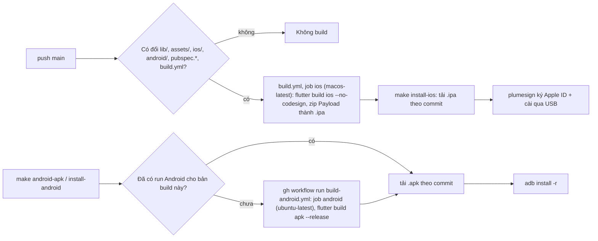

# Build và cài đặt

## Yêu cầu

- Flutter 3.50.1 (máy dev: `~/flutter`, Makefile tự tìm `flutter` trong `PATH` trước).
- `gh` đã đăng nhập (đọc được repo `mihb123/ttyd-keys`) cho `make ios-ipa` / `make android-apk` / `make install-*`.
- Cài iOS: `usbmuxd` + `libimobiledevice` + `jq`, cáp USB, Apple ID đã đăng nhập một lần trong Impactor (`~/.config/PlumeImpactor/accounts.json`). `make install-ios` tự tải `plumesign` (CLI của Impactor) nếu thiếu.
- Cài Android: `adb`, điện thoại bật gỡ lỗi USB.

## 1. Lệnh hằng ngày

| Lệnh | Việc |
|---|---|
| `make help` | Liệt kê lệnh |
| `make get` | `flutter pub get` |
| `make analyze` | `flutter analyze` (lint) |
| `make install-ios` | Lấy `.ipa` của commit hiện tại, ký bằng Apple ID và cài lên iPhone cắm USB (`scripts/install-build.sh`) |
| `make install-android` | Như `make android-apk`, rồi `adb install -r` |
| `make ios-ipa` | Chỉ tải `.ipa` chưa ký của commit hiện tại về `build-ios/`, chờ nếu đang build |
| `make android-apk` | Build `.apk` trên GitHub Actions nếu commit chưa có (`build-android.yml`, ~8 phút), chờ xong rồi tải về `build-android/` |
| `make docs-check` | Kiểm link tương đối, khung mục `docs/feature/*.md`, cú pháp mermaid (`scripts/check-docs.py` + mermaid-check) |

Chạy trên thiết bị khi có máy dev nối điện thoại/emulator: `flutter run`.

## 2. Biến môi trường

Chỉ `scripts/pull-build.sh`, `scripts/install-build.sh` và `Makefile` đọc; app không đọc biến môi trường.

| Biến | Mặc định | Ý nghĩa |
|---|---|---|
| `PLATFORM` | `ios` | `ios` hoặc `android` (Makefile tự đặt) |
| `REF` | `HEAD` | Commit/nhánh/tag muốn lấy build (vd `REF=origin/main`, `REF=abd8040`) |
| `WAIT` | `1` | `1` = chờ run đang chạy (kiểm mỗi 30 s), `0` = báo lỗi ngay |
| `OUT_DIR` | `build-ios/` / `build-android/` ở gốc repo | Thư mục lưu file (git bỏ qua) |
| `UDID` (install) | iPhone duy nhất trong `idevice_id -l` | Chọn iPhone khi cắm nhiều máy |
| `PLUMESIGN` (install) | `plumesign` trong `PATH`, không có thì `~/.local/bin/plumesign` (tự tải v2.7.3, kiểm sha256) | Binary ký + cài iOS |
| `RUST_LOG` (install) | `error,plumesign=info` | Mức log của plumesign (`debug` khi cần soi lỗi) |
| `ANDROID_SERIAL` (install) | máy Android duy nhất trong `adb devices` | Chọn máy Android |
| `REPO` | `mihb123/ttyd-keys` | Repo GitHub lấy artifact |
| `FLUTTER` (Makefile) | `flutter` trong `PATH`, không có thì `~/flutter/bin/flutter` | Binary Flutter |
| `NODE` (Makefile) | `node` trong `PATH`, không có thì bản mới nhất trong `~/.nvm` | Chạy kiểm mermaid |
| `MERMAID_CHECK` (Makefile) | `~/.claude/tools/mermaid-check/check-mermaid.mjs` | Thiếu thì `docs-check` bỏ qua mermaid kèm cảnh báo |

Tên file: `TtydKeys-<số run>-<sha 7 ký tự>-unsigned.ipa` / `TtydKeys-<số run>-<sha>.apk` (CI đặt sẵn; artifact cũ chưa có sha thì `pull-build.sh` đổi tên khi lưu).

Build gắn với commit: `pull-build.sh` lấy commit gần nhất tính từ `REF` có đổi file build (`lib`, `assets`, `ios`, `android`, `pubspec.*`, `build.yml`, khớp `on.push.paths`), rồi lấy run mới nhất của workflow (`build.yml` cho iOS, `build-android.yml` cho Android) có `headSha` cùng bản build đó (chính commit đó hoặc commit sau chỉ sửa docs/scripts). File đã có trong `build-<platform>/` thì không tải lại.

Không có run: iOS báo lỗi (chưa push). Android tự `gh workflow run build-android.yml --ref main` rồi chờ, với điều kiện `origin/main` đang ở đúng bản build đó (chưa push hoặc `main` đã có code mới hơn thì báo lỗi). Run hỏng/huỷ thì báo lỗi kèm lệnh `gh run rerun`.

## 3. CI/CD (GitHub Actions)

- Workflow: `.github/workflows/build.yml` (iOS, tự chạy khi push `main`) và `.github/workflows/build-android.yml` (Android, chỉ `workflow_dispatch`). Chạy tay: `gh workflow run build.yml -R mihb123/ttyd-keys` / `gh workflow run build-android.yml -R mihb123/ttyd-keys`.
- Run mới huỷ run cũ cùng nhánh, mỗi workflow riêng (`concurrency`). Số build iOS = `github.run_number`; `versionCode` Android = số commit trên `main` (`git rev-list --count HEAD`, cần `fetch-depth: 0`) để không lùi so với `.apk` cũ. Artifact giữ 14 ngày.
- Giới hạn: iOS 45 phút, Android 30 phút. Repo public nên runner chuẩn (`macos-latest`, `ubuntu-latest`) miễn phí, không trừ quota; chuyển lại private thì phút macOS tính hệ số 10. Job iOS có thể xếp hàng vài phút chờ runner macOS.
- Sửa chỉ tài liệu, `Makefile`, `scripts/`, `analysis_options.yaml`, `build-android.yml` không kích hoạt build.

## 4. Cài lên iPhone

Cắm iPhone (đã mở khoá, đã bấm Tin cậy), rồi `make install-ios`. `scripts/install-build.sh` làm:

1. Kiểm `idevice_id -l` có đúng một iPhone (hoặc `UDID`), `ideviceinfo` đọc được tên máy (đã pair), `accounts.json` của Impactor có tài khoản đang chọn.
2. Gọi `pull-build.sh` lấy `.ipa` của commit hiện tại.
3. `plumesign sign --package <ipa> --apple-id --register-and-install --udid <DeviceID>`: đăng ký máy + App ID với Apple, ký lại, cài qua USB (~7 s khi đã có file). File `.ipa` gốc không đổi (plumesign ký bản giải nén trong `TMPDIR` riêng, script xoá sau khi chạy).

`--udid` của plumesign v2.7.3 thực ra so với `DeviceID` số của usbmuxd (`plume_utils::get_device_for_id`), không phải UDID, nên script hỏi `/var/run/usbmuxd` (`ListDevices`) để đổi UDID sang `DeviceID`.

`plumesign` và Impactor dùng chung `~/.config/PlumeImpactor/` (tài khoản, khoá chứng chỉ) và cùng đổi bundle id thành `site.mihb.ttydKeys.<Team ID>`, nên cài bằng lệnh hay bằng giao diện Impactor đều đè lên cùng một app, dữ liệu giữ nguyên. Chưa đăng nhập: mở Impactor đăng nhập một lần, hoặc `plumesign account login -u <email>`.

Bản ký bằng Apple ID miễn phí hết hạn sau 7 ngày: chạy lại `make install-ios` (không gỡ app). Hướng dẫn cài Impactor, bật Chế độ nhà phát triển, tin cậy chứng chỉ: `~/thu-chi/docs/ios-codemagic.md`, phần "Phần cho người dùng".
