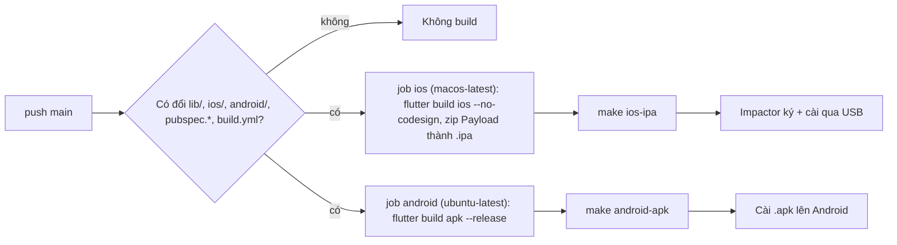

# Build và cài đặt

## Yêu cầu

- Flutter 3.50.1 (máy dev: `~/flutter`, Makefile tự tìm `flutter` trong `PATH` trước).
- `gh` đã đăng nhập (đọc được repo `mihb123/ttyd-keys`) cho `make ios-ipa` / `make android-apk`.
- Cài iOS: Impactor + cáp USB + Apple ID.

## 1. Lệnh hằng ngày

| Lệnh | Việc |
|---|---|
| `make help` | Liệt kê lệnh |
| `make get` | `flutter pub get` |
| `make analyze` | `flutter analyze` (lint) |
| `make ios-ipa` | Tải `.ipa` chưa ký mới nhất của `main` về `~/Downloads/ttyd-keys-ios`, chờ nếu đang build |
| `make android-apk` | Tải `.apk` mới nhất về `~/Downloads/ttyd-keys-android` |
| `make docs-check` | Kiểm link tương đối, khung mục `docs/feature/*.md`, cú pháp mermaid (`scripts/check-docs.py` + mermaid-check) |

Chạy trên thiết bị khi có máy dev nối điện thoại/emulator: `flutter run`.

## 2. Biến môi trường

Chỉ `scripts/pull-build.sh` và `Makefile` đọc; app không đọc biến môi trường.

| Biến | Mặc định | Ý nghĩa |
|---|---|---|
| `PLATFORM` | `ios` | `ios` hoặc `android` (Makefile tự đặt) |
| `BRANCH` | `main` | Nhánh lấy build |
| `WAIT` | `1` | `1` = chờ run đang chạy (kiểm mỗi 30 s), `0` = báo lỗi ngay |
| `OUT_DIR` | `~/Downloads/ttyd-keys-ios` / `-android` | Thư mục lưu file |
| `REPO` | `mihb123/ttyd-keys` | Repo GitHub lấy artifact |
| `FLUTTER` (Makefile) | `flutter` trong `PATH`, không có thì `~/flutter/bin/flutter` | Binary Flutter |
| `NODE` (Makefile) | `node` trong `PATH`, không có thì bản mới nhất trong `~/.nvm` | Chạy kiểm mermaid |
| `MERMAID_CHECK` (Makefile) | `~/.claude/tools/mermaid-check/check-mermaid.mjs` | Thiếu thì `docs-check` bỏ qua mermaid kèm cảnh báo |

Tên file tải về: `TtydKeys-<số run>-unsigned.ipa` / `TtydKeys-<số run>.apk`.

## 3. CI/CD (GitHub Actions)

- Workflow: `.github/workflows/build.yml`; chạy tay: `gh workflow run build.yml -R mihb123/ttyd-keys`.
- Run mới huỷ run cũ cùng nhánh (`concurrency`); số build = `github.run_number`. Artifact giữ 14 ngày.
- Giới hạn: iOS 45 phút, Android 30 phút. Repo private: phút macOS tính hệ số 10 vào quota Actions miễn phí.
- Sửa chỉ tài liệu, `Makefile`, `scripts/`, `analysis_options.yaml` không kích hoạt build.

## 4. Cài lên iPhone

Hướng dẫn chung dùng Impactor (Ubuntu + Apple ID miễn phí): `~/thu-chi/docs/ios-codemagic.md`, phần "Phần cho người dùng" (bỏ qua phần Codemagic, file `.ipa` lấy bằng `make ios-ipa`). Lưu ý (theo tài liệu đó): bản ký bằng Apple ID miễn phí hết hạn sau 7 ngày; cài đè lại bằng Impactor (cùng Apple ID, không gỡ app) thì dữ liệu vẫn giữ.
