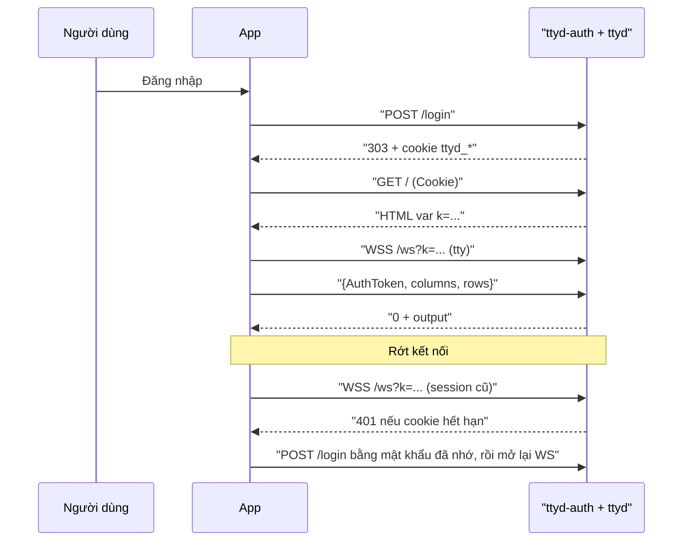

# Đăng nhập và kết nối ttyd

## Mục tiêu

Mở terminal ttyd (sau ttyd-auth) trong app native, tự đăng nhập lại khi phiên hết hạn và tự nối lại khi rớt mạng, để không phải gõ lại mật khẩu.

## Phạm vi hiện tại

- Màn đăng nhập: host, username, mật khẩu, "Nhớ mật khẩu". Đã nhớ mật khẩu thì mở app qua bước 2 (Face ID/PIN, [khoa-app.md](khoa-app.md)) rồi tự đăng nhập, vào thẳng terminal.
- Đèn trạng thái trên AppBar: xanh = đã kết nối, vàng = đang nối, đỏ = mất kết nối (kèm nút Kết nối lại).
- Chưa kết nối thì đáy vùng terminal có nút lớn: đỏ → "Kết nối lại", vàng → "Đang kết nối…" (không bấm được).
- Menu ⋮ → "Kết nối lại" luôn có: đóng socket hiện tại (kể cả socket còn mở nhưng đã chết) rồi nối lại.
- Tiêu đề AppBar = title ttyd gửi về, chưa có thì hiện host.
- Tự nối lại khi app quay về foreground hoặc khi rớt sau phiên dài hơn 5 s. Rời app từ 10 phút trở lên thì khoá trước ([khoa-app.md](khoa-app.md)), kết nối vẫn nối lại phía sau.
- Menu ⋮ → "Đăng xuất, quên mật khẩu".
- In output lớn (`cat` file dài) không treo app: output được ghi dần theo frame, tồn đọng nhiều thì tạm dừng server.
- Chưa có: nhiều host/nhiều tab, giữ shell khi rớt (phải dùng tmux), chứng chỉ tự ký.

## Code map

- `lib/ttyd_client.dart` — `login` (POST `/login` + GET `/` lấy khóa tab), `TtydConnection` (WebSocket, giải mã khung), `AuthException`, `normalizeHost`.
- `lib/main.dart` — `TtydKeysApp` (chọn màn đầu), `_LoginScreenState._submit`, `showLogin` (ẩn bàn phím, thay route).
- `lib/output_throttle.dart` — `OutputThrottle`: hàng đợi output, ghi vào `Terminal` theo ngân sách mỗi frame, gọi `onPause`/`onResume` khi tồn đọng.
- `lib/terminal_screen.dart` — `_TerminalScreenState`: `_output`, `_connect`, `_reconnect`, `_freshSession`, `_open`, `didChangeAppLifecycleState`, `_logout`, AppBar trạng thái.

## Luồng xử lý

1. `main` → `Settings.load()`; có `rememberPassword` + username + password → `TerminalScreen(lockOnStart: true)` (chưa có session, màn khoá phủ lên), ngược lại → `LoginScreen`.
2. `_LoginScreenState._submit`: chuẩn hoá host, gọi `login`, `Settings.save()`, nếu không nhớ mật khẩu thì xoá mật khẩu khỏi bộ nhớ, chuyển sang `TerminalScreen(initialSession)`.
3. `TerminalScreen` gọi `_connect` sau frame đầu (khi đã biết số cột/dòng).
4. `_connect`:
   - Bỏ qua nếu màn khoá đang phủ, đang đăng xuất, đang nối hoặc socket còn mở.
   - Có session → mở WS; lỗi chứa `401` → bỏ session.
   - Không có session → `_freshSession` (đăng nhập lại bằng mật khẩu đã nhớ); không nhớ → về màn đăng nhập "Phiên đã hết hạn, đăng nhập lại."
   - Mở được → trạng thái xanh, gửi lệnh tự chạy (nếu có), mở bàn phím (trừ khi màn khoá đang phủ).
   - `AuthException.wrongCredentials` → `_logout` (quên mật khẩu, xoá PIN), về màn đăng nhập. Lỗi khác → banner lỗi + nút "Thử lại".
5. Output (`onText`) → `OutputThrottle.add` xếp hàng; mỗi frame `_drain` ghi lát ≤ 8192 ký tự vào `Terminal` tới khi hết 10 ms rồi để frame vẽ. Tồn > 256K ký tự → `TtydConnection.pause` (ngừng đọc socket, server bị chặn theo TCP); còn < 64K → `resume`. Mở kết nối mới → `resetFlow`.
6. Socket đóng (`conn.done`) → xếp `[Mất kết nối]` vào cùng hàng đợi output, trạng thái đỏ; nếu app đang foreground và kết nối đã sống > 5 s → `_connect` lại.
7. Bấm Kết nối lại (nút lớn, nút AppBar, mục menu, "Thử lại" ở banner) → `_reconnect`: bỏ qua nếu đang nối, đang khoá hoặc đang đăng xuất; gán `_conn = null`, đóng socket cũ (`TtydConnection.close` huỷ listener trước nên output còn tồn của socket cũ không ghi vào terminal; handler `conn.done` của socket cũ bỏ qua vì `_conn != conn`, không in `[Mất kết nối]`), gọi `_connect`.
8. App về foreground (`AppLifecycleState.resumed`) khi đang đỏ → `_connect`; ở nền ≥ 10 phút thì `_lockNow` trước ([khoa-app.md](khoa-app.md)).

## Dữ liệu & giao thức

- Endpoint, khung tin nhắn, timeout: [api_specifications.md](../api_specifications.md).
- Mật khẩu, host, username: [cai-dat.md](cai-dat.md).

## Quy tắc & lưu ý

- Chỉ nối lại tự động khi kết nối trước sống > 5 s: tránh vòng lặp nối/đóng liên tục khi server từ chối ngay.
- Lệnh tự chạy gửi sau khung output đầu tiên hoặc tối đa 3 s, và chỉ gửi nếu kết nối đó vẫn là kết nối hiện tại.
- Phát hiện cookie hết hạn bằng chuỗi `401` trong message của `WebSocketException` (phụ thuộc thông báo lỗi của `dart:io`).
- Không ghi output thẳng vào `_terminal.write`, luôn qua `_output.add` để giữ thứ tự và không chặn luồng UI. xterm đã chỉ vẽ dòng trong viewport; phần chậm là parse, nên giới hạn theo thời gian parse mỗi frame.
- Hàng đợi tối đa ~256K ký tự nên màn hình chỉ trễ output thật một đoạn ngắn, Ctrl+C dừng gần như ngay. Không dùng khung PAUSE của ttyd vì ttyd 1.7.4 bỏ qua ([api_specifications.md](../api_specifications.md#khung-tin-nhắn-ttyd-174)).
- xterm tự bám đáy (`_stickToBottom` trong `RenderTerminal`) khi view đang ở đáy; người dùng cuộn lên thì đứng yên như terminal thật.
- Lỗi xác thực hiển thị qua `AuthException.message` (tiếng Việt); lỗi mạng/WS có tiền tố tiếng Việt kèm chi tiết gốc của `dart:io`.

## Còn để lại

- Lỗi chưa sửa: host có cổng (`example.com:8443`) đăng nhập được (`Uri.https`) nhưng mở WS lỗi `FormatException: Illegal IPv6 address` vì `TtydConnection.open` dựng `Uri(scheme: 'wss', host: session.host)`.
- `_LoginScreenState._submit` gọi `setState` trong hai nhánh `catch` không kiểm `mounted`.
- Ở nền không có frame nên hàng đợi không chạy; đang in nhiều mà rời app > 10 s thì socket dừng đọc quá ping, kết nối đóng, về foreground tự nối lại.
- Không có tmux thì `cat` file rất lớn chạy theo tốc độ parse của xterm (in đủ từng dòng); có tmux thì tmux tự bỏ khung trung gian nên nhanh hơn.
- Server trả mã khác `401` khi cookie hết hạn (vd `403`) thì app chỉ báo lỗi, không tự đăng nhập lại.
