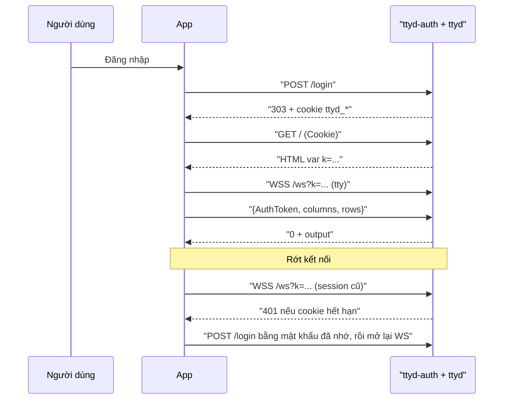

# Đăng nhập và kết nối ttyd

## Mục tiêu

Mở terminal ttyd (sau ttyd-auth) trong app native, tự đăng nhập lại khi phiên hết hạn và tự nối lại khi rớt mạng, để không phải gõ lại mật khẩu.

## Phạm vi hiện tại

- Màn đăng nhập: host, username, mật khẩu, "Nhớ mật khẩu". Đã nhớ mật khẩu thì mở app vào thẳng terminal.
- Đèn trạng thái trên AppBar: xanh = đã kết nối, vàng = đang nối, đỏ = mất kết nối (kèm nút Kết nối lại).
- Tiêu đề AppBar = title ttyd gửi về, chưa có thì hiện host.
- Tự nối lại khi app quay về foreground hoặc khi rớt sau phiên dài hơn 5 s.
- Menu ⋮ → "Đăng xuất, quên mật khẩu".
- Chưa có: nhiều host/nhiều tab, giữ shell khi rớt (phải dùng tmux), chứng chỉ tự ký.

## Code map

- `lib/ttyd_client.dart` — `login` (POST `/login` + GET `/` lấy khóa tab), `TtydConnection` (WebSocket, giải mã khung), `AuthException`, `normalizeHost`.
- `lib/main.dart` — `TtydKeysApp` (chọn màn đầu), `_LoginScreenState._submit`, `showLogin` (ẩn bàn phím, thay route).
- `lib/terminal_screen.dart` — `_TerminalScreenState`: `_connect`, `_freshSession`, `_open`, `didChangeAppLifecycleState`, `_logout`, AppBar trạng thái.

## Luồng xử lý

1. `main` → `Settings.load()`; có `rememberPassword` + username + password → `TerminalScreen` (chưa có session), ngược lại → `LoginScreen`.
2. `_LoginScreenState._submit`: chuẩn hoá host, gọi `login`, `Settings.save()`, nếu không nhớ mật khẩu thì xoá mật khẩu khỏi bộ nhớ, chuyển sang `TerminalScreen(initialSession)`.
3. `TerminalScreen` gọi `_connect` sau frame đầu (khi đã biết số cột/dòng).
4. `_connect`:
   - Bỏ qua nếu đang nối hoặc socket còn mở.
   - Có session → mở WS; lỗi chứa `401` → bỏ session.
   - Không có session → `_freshSession` (đăng nhập lại bằng mật khẩu đã nhớ); không nhớ → về màn đăng nhập "Phiên đã hết hạn, đăng nhập lại."
   - Mở được → trạng thái xanh, gửi lệnh tự chạy (nếu có), mở bàn phím.
   - `AuthException.wrongCredentials` → quên mật khẩu, về màn đăng nhập. Lỗi khác → banner lỗi + nút "Thử lại".
5. Socket đóng (`conn.done`) → in `[Mất kết nối]` vào terminal, trạng thái đỏ; nếu app đang foreground và kết nối đã sống > 5 s → `_connect` lại.
6. App về foreground (`AppLifecycleState.resumed`) khi đang đỏ → `_connect`.

## Dữ liệu & giao thức

- Endpoint, khung tin nhắn, timeout: [api_specifications.md](../api_specifications.md).
- Mật khẩu, host, username: [cai-dat.md](cai-dat.md).

## Quy tắc & lưu ý

- Chỉ nối lại tự động khi kết nối trước sống > 5 s: tránh vòng lặp nối/đóng liên tục khi server từ chối ngay.
- Lệnh tự chạy gửi sau khung output đầu tiên hoặc tối đa 3 s, và chỉ gửi nếu kết nối đó vẫn là kết nối hiện tại.
- Phát hiện cookie hết hạn bằng chuỗi `401` trong message của `WebSocketException` (phụ thuộc thông báo lỗi của `dart:io`).
- Lỗi xác thực hiển thị qua `AuthException.message` (tiếng Việt); lỗi mạng/WS có tiền tố tiếng Việt kèm chi tiết gốc của `dart:io`.

## Còn để lại

- Lỗi chưa sửa: host có cổng (`example.com:8443`) đăng nhập được (`Uri.https`) nhưng mở WS lỗi `FormatException: Illegal IPv6 address` vì `TtydConnection.open` dựng `Uri(scheme: 'wss', host: session.host)`.
- Nghi lỗi: `_logout` đặt `_conn = null` sau `await _conn?.close()`. Nếu server đóng socket trong lúc đang chờ `close()`, callback `conn.done` thấy `_conn == conn` và có thể gọi `_connect` (đăng nhập lại bằng mật khẩu chưa kịp xoá) rồi mới bị đóng khi màn unmount.
- `_LoginScreenState._submit` gọi `setState` trong hai nhánh `catch` không kiểm `mounted`.
- Server trả mã khác `401` khi cookie hết hạn (vd `403`) thì app chỉ báo lỗi, không tự đăng nhập lại.
