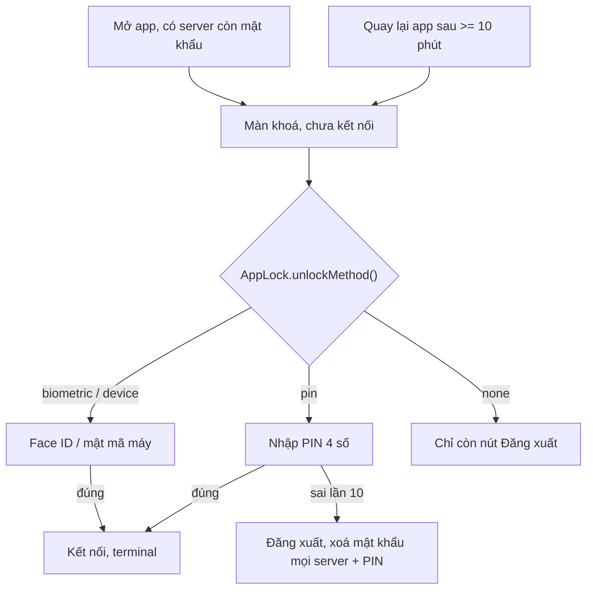

# Khoá app (xác thực bước 2)

## Mục tiêu

Mật khẩu đã lưu cho phép tự đăng nhập, nên người cầm máy phải qua thêm bước 2 trên máy (Face ID/Touch ID/vân tay, hoặc mã PIN 4 số) mới thấy terminal. Rời app ngắn thì không bị hỏi lại.

## Phạm vi hiện tại

- Mở app khi có server còn lưu mật khẩu: màn khoá hiện trước; xác thực xong mới tự đăng nhập, mở WS và chạy lệnh tự chạy.
- Rời app (app ở nền) từ 10 phút trở lên rồi quay lại: khoá. Dưới 10 phút: vào thẳng, chỉ nối lại nếu đã mất kết nối.
- Máy có sinh trắc học: tự bật Face ID (hoặc vân tay) khi màn khoá hiện và khi quay lại app trong lúc còn khoá, nút "Mở khoá bằng Face ID" để thử lại; lỗi nhiều lần thì hệ điều hành cho nhập mật mã máy.
- Máy không có sinh trắc học: ngay sau khi đăng nhập bằng mật khẩu bắt tạo mã PIN 4 số (nhập 2 lần); sau đó mở khoá bằng mã PIN. Sai 10 lần liên tiếp thì tự đăng xuất (xoá mật khẩu mọi server và mã PIN, giữ danh sách server).
- Sinh trắc học bị tắt quyền/tạm khoá mà chưa có PIN: mở khoá bằng mật mã máy (không cho tạo PIN mới khi đang khoá).
- App không ở foreground (kể cả `inactive`): phủ màn đen để trình chuyển app không chụp được nội dung terminal.
- Nút "Đăng xuất" trên màn khoá (quên mã PIN thì đăng xuất, đăng nhập lại bằng mật khẩu, tạo mã mới).
- Chưa có: đổi mã PIN trong Cài đặt, tuỳ chỉnh thời gian 10 phút.

## Code map

- `lib/app_lock.dart` — `AppLock`: `hasBiometrics`, `biometricLabel`, `hasPin`, `needsPinSetup`, `unlockMethod` (`LockMethod.biometric/device/pin/none`), `authenticate` (`local_auth`, trả thông báo lỗi tiếng Việt hoặc `null`), `setPin`, `verifyPin` (`PinOk`/`PinWrong`/`PinExhausted`/`PinMissing`), `clear`; hằng `lockAfter`, `pinLength`, `maxPinAttempts`.
- `lib/lock_screen.dart` — `LockScreen`: màn khoá/tạo PIN, bàn phím số riêng (không dùng bàn phím ảo); tự hỏi lại sinh trắc học khi app quay về từ nền (`didChangeAppLifecycleState`).
- `lib/terminal_screen.dart` — `_TerminalScreenState`: `_covered`, `_curtain`, `_checkPinSetup`, `_lockNow` (đóng cả sidebar), `_onUnlocked`, `didChangeAppLifecycleState`, `canConnect` truyền cho `ServerSession` (false khi `_covered`), `_logout` (chống gọi 2 lần); `build` xếp terminal (bọc `ExcludeSemantics`/`ExcludeFocus`/`IgnorePointer` khi khoá), màn che, `LockScreen` bằng `Stack`.
- `lib/main.dart` — `TtydKeysApp`: mở `TerminalScreen(lockOnStart: true)` khi `Settings.hasAnyPassword`.

## Luồng xử lý

1. `TtydKeysApp` thấy `hasAnyPassword` → `TerminalScreen(lockOnStart: true)`: `_locked = true`; `ServerSession.connect` thoát ngay khi `_covered`, nên chưa đăng nhập/mở shell.
2. Vừa đăng nhập bằng mật khẩu (`lockOnStart: false`): màn che tới khi `_checkPinSetup` xong; `AppLock.needsPinSetup()` (không sinh trắc học, chưa có PIN) → `LockScreen(setup: true)`. Không bao giờ chạy khi đang khoá.
3. `LockScreen._init` gọi `AppLock.unlockMethod()`: `biometric`/`device` → tự gọi `authenticate`; `pin` → bàn phím số; `none` → chỉ còn nút Đăng xuất.
4. Mở khoá xong → `_onUnlocked`: bỏ khoá; WS của server đang xem còn mở thì mở bàn phím, server cần mật khẩu thì mở form server, không thì `connect`.
5. `didChangeAppLifecycleState`: `inactive` → màn che; `hidden`/`paused` → màn che, ghi `_backgroundAt` (lần đầu), đóng menu chọn chữ; `resumed` → ở nền ≥ `AppLock.lockAfter` (hoặc đồng hồ bị lùi) thì `_lockNow` (ẩn bàn phím, đóng sheet/menu, khoá), bỏ màn che, nối lại nếu đang đỏ (bị chặn nếu đang khoá).
6. Nhập PIN đủ 4 số → `verifyPin`: đúng → xoá bộ đếm; sai → tăng `pinFails`, báo "Sai mã PIN, còn N lần thử."; lần thứ 10 → `clear()` + `_logout(error: ...)`: ngắt mọi server, `forgetAllPasswords`, về màn đăng nhập điền sẵn server gần nhất "Nhập sai mã PIN quá 10 lần, đã đăng xuất."

## Dữ liệu & giao thức

- Lưu trữ: `pinHash`, `pinFails` trong `flutter_secure_storage` (chi tiết: [cai-dat.md](cai-dat.md)).
- Không gửi gì lên server; khoá chỉ chạy trên máy.

## Quy tắc & lưu ý

- `AppLock.lockAfter` = 10 phút, `pinLength` = 4, `maxPinAttempts` = 10 (`lib/app_lock.dart`).
- Chỉ `hidden`/`paused` tính là rời app; `inactive` (hộp Face ID, Trung tâm điều khiển, kéo thông báo) không tính, nếu không chính Face ID sẽ làm app khoá lại.
- PIN lưu dạng `salt:sha256(salt:pin)` (salt 16 byte ngẫu nhiên), không lưu PIN thô, Keychain `unlocked_this_device` (không theo bản sao lưu sang máy khác). Bộ đếm sai nằm cùng Keychain nên tắt app không reset được.
- Chỉ tạo PIN ngay sau khi đăng nhập bằng mật khẩu. Nếu cho tạo PIN lúc đang khoá thì tắt quyền Face ID của app trong Cài đặt iOS (không cần mật mã máy) là vượt được khoá; khi đó dùng mật mã máy (`LockMethod.device`).
- Đăng xuất (`_logout`, từ màn khoá) và xoá server cuối cùng đều xoá mã PIN: quên PIN thì đăng xuất rồi đăng nhập bằng mật khẩu là đặt lại được. Tự đăng nhập lại báo sai mật khẩu chỉ xoá mật khẩu của server đó, không xoá PIN.
- `authenticate` dùng `biometricOnly: false` (cho rơi về mật mã máy), không dùng `persistAcrossBackgrounding` (plugin giữ lời gọi treo qua nền, kể cả sau khi đã đăng xuất); `LockScreen` tự gọi lại khi app quay về từ nền.
- iOS cần `NSFaceIDUsageDescription` trong `ios/Runner/Info.plist`; Android cần `MainActivity` kế thừa `FlutterFragmentActivity` (quyền `USE_BIOMETRIC` do plugin tự thêm).
- `ServerSession.connect` thoát khi màn khoá đang phủ (`canConnect` false): shell và lệnh tự chạy chỉ chạy sau xác thực bước 2. Màn khoá dùng bàn phím số riêng nên không tranh focus với `TerminalInput`.

## Còn để lại

- Khoá khi quay lại sau ≥ 10 phút nhưng WS cũ vẫn sống: kết nối giữ nguyên phía sau màn khoá (không đóng).
- Rớt mạng khi đang dùng (chưa rời app 10 phút) tự nối lại, không hỏi Face ID.
- Android 8 trở xuống: `local_auth` yêu cầu `LaunchTheme` kế thừa `Theme.AppCompat`, chưa đổi (chưa kiểm trên máy thật).
- Chưa thử trên máy thật: Face ID, PIN, khoá sau 10 phút.
