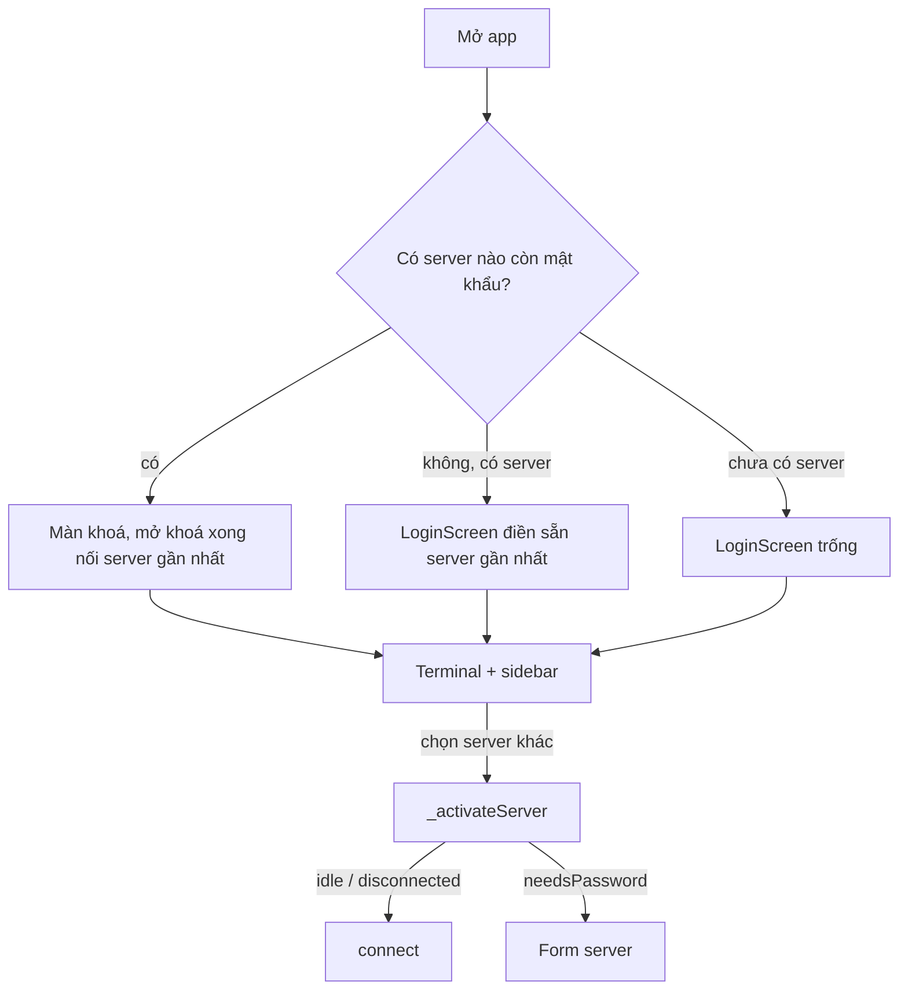

# Nhiều server

## Mục tiêu

Mỗi server chỉ cần đăng nhập một lần, sau đó chuyển qua lại giữa các server bằng sidebar vuốt từ mép trái (giống session của Termux). Server đã mở vẫn giữ kết nối khi bạn xem server khác.

## Phạm vi hiện tại

- Sidebar (Drawer): mở bằng cách vuốt từ mép trái (vùng 28 px) hoặc bấm nút ☰ trên AppBar. Mỗi server hiện một chấm trạng thái (xanh đã nối, vàng đang nối, đỏ mất kết nối, xám chưa nối/đã ngắt), dòng tên và dòng `username@host`. Server đang xem được tô nền.
- Bấm một server để chuyển sang. Lần đầu chọn thì mới nối; từ đó kết nối được giữ, lịch sử cuộn và vị trí cuộn còn nguyên khi quay lại.
- Nhấn giữ một server: Sửa, Ngắt kết nối (chỉ khi đang nối hoặc đã nối), Xoá server (có hộp xác nhận). Cuối sidebar có nút "+ Thêm server".
- Menu ⋮ của server đang xem: Kết nối lại, Cài đặt, Sửa server, Xoá server.
- Form server: Tên hiển thị (tuỳ chọn, để trống thì hiện host), Host, Username, Mật khẩu, Lệnh tự chạy. Mật khẩu luôn được lưu, không còn ô "Nhớ mật khẩu". Không cho thêm server trùng host + username.
- Mở app: qua Face ID/PIN rồi chỉ nối server dùng gần nhất.
- Chưa có: nhiều tab trên cùng một server (dùng tmux), kéo để sắp xếp server, đồng bộ danh sách server giữa các máy.

## Code map

- `lib/settings.dart` — `ServerProfile` (`label`, `toJson`/`fromJson`); `Settings`: `servers`, `activeServerId`, `activeServer`, `hasAnyPassword`, `removeServer`, `forgetPassword(server)`, `forgetAllPasswords`, `_migrateSingleHost`.
- `lib/server_session.dart` — `ServerSession` (`ChangeNotifier`, mỗi server một instance): `FixedTerminal` + `OutputThrottle` riêng, `connect`, `reconnect`, `replaceSession`, `disconnect`, `dispose`; enum `ServerStatus { idle, connecting, connected, disconnected }`.
- `lib/server_drawer.dart` — `ServerDrawer` (danh sách + sheet thao tác khi nhấn giữ), `serverStatusColor`.
- `lib/terminal_screen.dart` — `_TerminalScreenState`: `_sessions`, `_viewKeys`, `_scrollControllers` (theo `profile.id`), `_activateServer`, `_openServerForm`, `_applyServerFormResult`, `_confirmDeleteServer`, `_deleteServer`, `_onSessionNeedPassword`.
- `lib/main.dart` — `LoginScreen` (thêm/sửa server, `isRoot`), `LoginResult`, `TtydKeysApp` (chọn màn đầu).

## Luồng xử lý

1. Chuyển server (`_activateServer`): xoá vùng chọn chữ, gắn listener vào terminal và `ScrollController` của server mới, lưu `activeServerId`. Sau frame (khi `TerminalView` đã có kích thước thật): server cần mật khẩu thì mở form; đang `idle`/`disconnected` thì `connect`; đã nối thì mở bàn phím.
2. `TerminalView` được dựng lại theo `GlobalKey` riêng của từng server. Mỗi server có `ScrollController` riêng, vì dùng chung một controller sẽ báo lỗi "attached to multiple scroll views" lúc đổi view.
3. Thêm server: `_openServerForm()` push `LoginScreen(isRoot: false)`. `login` thành công thì thêm `ServerProfile`, `save()`, rồi pop `LoginResult`. Màn hình tạo `ServerSession` với `TtydSession` vừa nhận và chuyển sang server đó.
4. Sửa server: form ghi đè profile sau khi `login` thành công. `_applyServerFormResult` gọi `replaceSession`, đóng kết nối cũ và nối lại bằng session mới, lệnh tự chạy dùng giá trị mới.
5. Tự đăng nhập lại báo sai mật khẩu, hoặc server chưa có mật khẩu: `ServerSession` xoá mật khẩu của server đó, chuyển trạng thái đỏ, đặt `needsPassword` rồi gọi `onNeedPassword`. Server đang xem và không bị khoá thì mở form ngay; server khác thì đợi tới khi được chọn. Banner lỗi có nút "Nhập mật khẩu".
6. Rớt kết nối: chỉ server đang xem tự nối lại (cùng điều kiện ở [ket-noi-ttyd.md](ket-noi-ttyd.md)). Server ở nền giữ trạng thái đỏ và nối lại khi được chọn.
7. Xoá server (`_deleteServer`): `Settings.removeServer`, dispose `ServerSession`. Server đang xem thì chuyển sang `activeServer` mới. Xoá server cuối cùng thì `AppLock.clear()` rồi về màn đăng nhập trống.

## Dữ liệu & giao thức

- Lưu trữ: `servers` (JSON, không có mật khẩu), `activeServerId`, mật khẩu ở `password.<id>` trong Keychain/Keystore (chi tiết: [cai-dat.md](cai-dat.md)).
- Giao thức không đổi: mỗi server một `TtydSession` + `TtydConnection` riêng ([api_specifications.md](../api_specifications.md)).

## Quy tắc & lưu ý

- Dữ liệu cũ một host (`host`, `username`, `startupCommand`, `password`) được `Settings.load` → `_migrateSingleHost` chuyển thành server đầu tiên một lần, rồi xoá key cũ.
- Cỡ chữ, thanh phím và khoá app dùng chung cho mọi server. Lệnh tự chạy là riêng của từng server.
- Server ở nền vẫn nhận và parse output (`OutputThrottle` chạy theo frame). Terminal của nó chỉ resize khi được chọn lại, vì `TerminalView` mới gửi kích thước lúc layout.
- Màn khoá phủ lên thì không server nào được `connect` (`canConnect`). `_lockNow` đóng sidebar và pop form server đang mở.
- Đăng xuất từ màn khoá (quên PIN, sai PIN 10 lần) thì giữ danh sách server, chỉ xoá mật khẩu của mọi server và mã PIN ([khoa-app.md](khoa-app.md)).

## Còn để lại

- Chưa thử trên máy thật: vuốt mở sidebar ở mép trái có tranh với cử chỉ hệ thống (Android back gesture) hay với việc kéo đầu chọn chữ sát mép không.
- Mỗi server một buffer tối đa 10000 dòng: mở nhiều server cùng lúc sẽ tốn bộ nhớ theo số server.
- Màn đăng nhập gốc (khi mọi mật khẩu đã bị xoá) chỉ nhập lại mật khẩu cho server gần nhất; muốn xoá hay thêm server khác thì phải vào terminal trước.
